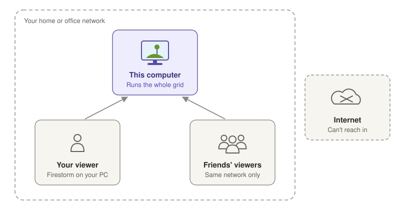
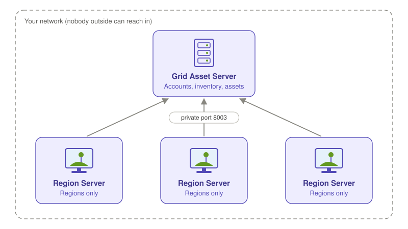

# GridGate-OpenSim

Your own OpenSimulator world, installed with one command and run from your browser.

This repository packages [OpenSim](http://opensimulator.org) with everything a world
needs: its own MariaDB database, the Robust grid services, the regions, and
**GridGate**, the website you run it all from. The installed package and its
service use the same name, so that is what you'll see in folders,
the service and the installer files.

It started as a fork of Outworldz DreamGrid and is now developed on its own, on
Debian Linux as well as Windows.

## What you get

**For you and your staff (the GridGate admin pages):**

* **A setup wizard** that names your world, creates your avatar and picks a
  [plan](#plans):
  * **Local:** just you and friends on your own network.
  * **Simple Public Server:** a world open to the internet.
  * **Grid Asset Server:** the centre of a grid other computers add regions to.
  * **Region Server:** this computer adds regions to someone's Grid Asset Server.
  * **Connected Server:** your regions on someone else's grid.
* **Home:** what's running, who's in-world, sign-ups waiting, and power controls
  for the whole world.
* **Regions:** a grid map you add regions to by dragging a region type onto it,
  each region's settings, moving regions, running several regions together to
  share memory, and saving or loading regions as OAR files.
* **[Physics engines](#physics-engines) per region:**
  * **ubODE**, the default. It starts mesh-heavy regions quickly, because GridGate
    fixed a slow step in it.
  * **Rapier**, experimental, where its library is available. It handles regions
    with many moving objects better, but starts mesh-heavy regions more slowly and
    uses more memory.
  * **BulletSim**.
* **[Money](#money), coming in a later release:** play coins, real coins or
  Gloebit, with GridGate's own ledger.
* **People:** find residents, staff roles (owner, admin, supervisor), sign-up
  approval, support tickets, groups, estates, hypergrid links and takedowns.
* **Guest pages:** the splash page the viewer shows (with its own editor), the
  legal pages (Terms, Privacy, Cookies, Contact), sign-up with bot protection,
  the email server and password reset.
* **Security:** two-factor sign-in for staff, and you can limit the admin pages
  to the networks you name.

**For your residents (the GridGate guest pages):** a front page to sign in or
create an account, how to connect with Firestorm, their own account page, and a
way to ask for help.

## Plans

The first setup page asks what this computer will be. In the charts, purple
boxes are computers running GridGate, gray boxes are people and equipment, teal
is a grid someone else runs, and a dashed outline is your home or office
network.

You can move between Local, Simple Public Server and Grid Asset Server later,
in **Settings → Plan**. Moving to or from Region Server or Connected Server
means a new install.

### One computer

**Local** is the simplest start: everything runs on this computer, and only
computers on the same network can visit.

**Simple Public Server** is the same single computer, opened to the internet.
Your router forwards the grid's port (8002) and the region ports to it, and one
switch turns on hypergrid travel to and from other grids.

### Several computers

**Grid Asset Server with Region Servers.** One computer keeps the grid's
accounts, inventory and assets; every other computer on your network adds land
to it as a Region Server, joining on the private port 8003. Kept on your network
only, nobody outside can visit:

Give the Grid Asset Server a public address and the same grid opens to the
internet: the router forwards 8002 to the Grid Asset Server and each Region
Server's region ports to that computer.

**Connected Servers** run regions on a grid someone else runs, such as OSgrid.
That grid keeps the accounts and decides about hypergrid, and computers in
different homes can each add their own regions to it.

## Install

Every computer gets the same installer, whatever its plan. Each install ends
with a link: open it in your browser to pick the plan, name your world and
create your avatar. GridGate then sets the computer up for that plan.

### Debian 12 and 13 (amd64)

Run this as a user who can use sudo:

    curl -fsSL https://github.com/ystudy/GridGate-OpenSim/releases/latest/download/install.sh | sudo bash

It installs the system packages GridGate needs (MariaDB, libgdiplus, ICU),
downloads the latest release and checks it against the release's SHA256SUMS,
creates a `gridgate` system user, and installs and starts the `gridgate`
systemd service. It then prints the setup link.

To install a release you've already downloaded (for example on a computer
without internet access), pass the file:

    sudo bash install.sh --from gridgate-<version>-linux-x64.tar.gz

### Windows 10 and 11 (x64)

Download `GridGateSetup-<version>.exe` from the
[latest release](https://github.com/ystudy/GridGate-OpenSim/releases/latest)
and run it. The installer is not signed, so Windows SmartScreen may say
"Windows protected your PC": click **More info → Run anyway**. Allow
GridGate through the firewall if Windows asks. The installer sets up the
GridGate service and opens the setup link in your browser when it finishes;
the Start menu entry "GridGate admin page" opens the admin website later.

### Where things live

| | Debian | Windows |
|---|---|---|
| Your world's data (database, regions, settings, logs) | `/var/lib/gridgate` | `C:\ProgramData\GridGate` |
| The program | `/opt/gridgate` (its .NET runtime: `/opt/gridgate-runtime`) | `C:\Program Files\GridGate` |

Installing, upgrading and uninstalling never change, move or delete the data
folder.

### Upgrading

Run the same command again on Debian, or the newer installer on Windows. Your
world keeps running while the program is replaced, and the data is kept. The
grid service and regions restart briefly when a release updates OpenSim.

### Another web port

The admin website uses port 8001. If another program already uses it, pick
another port from 1024 to 65535 (not one GridGate uses itself: 3307, 8002,
8003, 8004, 8010 or 8011):

    curl -fsSL https://github.com/ystudy/GridGate-OpenSim/releases/latest/download/install.sh | sudo bash -s -- --web-port 8101

    GridGateSetup-<version>.exe /WEBPORT=8101

The installer saves the port in your world's settings, so upgrades keep it, and
you can change it later in Settings → Network.

### Testing a pre-release

Pre-releases (tags such as `v0.1.0-rc1`) are never the latest release, so the
commands above do not pick them up. On Debian, name the tag:

    curl -fsSL https://github.com/ystudy/GridGate-OpenSim/releases/download/v0.1.0-rc1/install.sh | sudo GRIDGATE_RELEASE=v0.1.0-rc1 bash

On Windows, download `GridGateSetup-<version>.exe` from that pre-release's
page on the [releases list](https://github.com/ystudy/GridGate-OpenSim/releases).

## Adding more computers

Set up the Grid Asset Server first. Then, on each other computer on the same
network, install the same GridGate version, choose **Region Server**, and type
the Grid Asset Server's address. GridGate reads everything else it needs from
that computer. You sign in with the avatar you already have there: no new
account.

Keep in mind:

* If the Grid Asset Server is off, every Region Server's regions stop working.
* Every computer on your network can reach the Grid Asset Server's private port
  (8003), so anyone on your network can add regions to the grid.
* Never forward the money port (8000 unless you changed it) on your router.

## Connecting with a viewer

Your world's login address is on the GridGate Home page (and on the guest
Connect page your residents see), for example `http://192.168.1.20:8002/`. Add it
in Firestorm under **Preferences → OpenSim → Grid Manager**, then sign in with
your avatar's name and password.

## Physics engines

You pick the engine on a region's **Physics** settings tab (regions that run
together in one program share it). Which one is faster depends on what the
region does:

* **For a region full of mesh, choose ubODE.** GridGate fixed the step that made
  mesh-heavy regions slow to start, so a region with about 5,000 meshes is ready
  in about 5 seconds instead of 20. Rapier takes about 8 seconds and more than
  twice the memory.
* **For a region with many moving objects, Rapier is ahead.** A pile of 500
  objects costs it about a quarter of ubODE's time. At 2,000 moving objects it
  needs about half, while ubODE can't keep up and the region slows to a quarter
  speed. At 1,000 spread-out objects the two are about even. In quiet regions
  ubODE is the cheaper one, but both have plenty of time to spare.

Rapier stays experimental until walking, vehicles and mesh floors have been
checked in a viewer.

The last part of the chart is a test, not a GridGate feature yet: freezing an
idle region and waking it when someone arrives, which takes hundredths of a
second instead of a fresh start.

![Physics engines compared. Running a busy region, physics milliseconds in each 91 ms frame for ubODE and Rapier: 100 objects moving 1.5 and 3.0; 500 objects in a pile 48.4 and 10.9; 1,000 moving 29.3 and 26.5; 2,000 moving 121.4, which slows the region to a quarter speed, and 57.9; the DragonFyre region with a 500-object pile 54.8 and 14.2. Starting DragonFyre, 4,090 objects and about 5,000 meshes: ubODE before GridGate's fix 19.7 seconds, ubODE in GridGate 5.3 seconds with 465 MB of memory, Rapier 7.8 seconds with 1,150 MB. Freezing and waking, a bench test not yet in GridGate: starting from cold 5.3 seconds, freezing 0.005 seconds with memory going from 468 MB to 82 MB, waking 0.015 seconds.](docs/images/physics/physics-engines.svg)

The numbers come from a small test computer (2 cores, 2 GB of memory); see the
[Rapier results](docs/superpowers/specs/2026-11-06-rapier-early-results.md) for
how they were measured.

## Money

GridGate has its own money system, so residents can tip a DJ, buy from a vendor,
pay for land or rent, and see their balance in Firestorm's status bar.

**Money is switched off in this version of GridGate.** It will be turned on in
a later release, once the money code has passed its security review.

On the **Money** page the grid's owner will choose one of four modes:

* **Off:** no money, as today.
* **Play coins:** a currency that isn't real money. Games of chance are fine here.
  Switching to real coins warns that they then count as gambling.
* **Real coins:** the same coins, bought with real money. Staff add the coins by
  hand once a payment arrives. Coins are never cashed back into money, and
  balances carry over from play coins.
* **Gloebit:** the outside Gloebit service, for grids that want artists paid in
  real money. Gloebit handles the payments and the cash-outs.

What it covers:

* **Everything people do with money in Second Life:** buying objects, paying an
  avatar or an object (tip jars, vendors, rental boxes), scripts that pay out,
  buying land, and optional fees for uploads, groups and classified ads.
* **The books:** every coin is in one ledger. Staff see totals, each person's
  history and every payment. They can give coins or take them back with a
  reason, and freeze payments. A self-check raises an alarm if the books don't
  balance.
* **Residents:** a My coins page with their own history. A switch lets scripts pay
  out from their balance, up to a daily limit.
* **Visitors from other grids:** they can be tipped and can spend at events.
* **Several computers:** the ledger runs on the Grid Asset Server. Each Region
  Server pairs with it using a one-time code, and its key only works for avatars
  in its own regions.

### Why not the usual OpenSim money server

Most self-run OpenSim grids use the DTL/NSL Money Server. Reading its code showed
that anyone who can reach its port can create money or move anyone's money, and
two payments at once can overdraw an account. GridGate doesn't use any of its
code. The [money design](docs/superpowers/specs/2026-11-13-money-design.md)
(§13.1) has the details.

### Fixes to OpenSim

Building the money system turned up bugs in how OpenSim itself handles money.
Most of them let a scammer take someone else's money, or let a grid's fees be
skipped. GridGate fixed them in OpenSim's own code, so the fixes are in every
build, whether money is on or not. They matter to anyone who runs a money
module on OpenSim, not only to GridGate.

**First, how a script spends money.** Money normally moves because a person
chooses to pay: they right-click an object or an avatar, pick Pay and type the
amount. No script can raise that amount. A script can also pay money *out*,
with `llGiveMoney` or `llTransferLindenDollars`, for change, refunds, prizes or
splitting a sale with a partner. That money always comes from the **object's
owner**. Before a script may do that, it has to ask for `PERMISSION_DEBIT`, and
someone has to click Yes on a dialog. Most of the bugs below are about *who*
that Yes came from.

#### BUG FIX - A script could spend its owner's money without asking the owner

OpenSim sent the `PERMISSION_DEBIT` question to whoever the script named, and
never checked that this person was the owner.

* **How a scammer could use it:** a scammer sells or gives away a script, for
  example a "tip jar" script. You put it in your object. When a visitor touches
  the jar, the script asks *the visitor* for permission to take money. The
  visitor clicks Yes without reading. The script can now pay the scammer out of
  **your** balance, and you never saw a dialog.
* **The fix:** `llGiveMoney` and `llTransferLindenDollars` refuse to pay unless
  the person who said Yes is the object's current owner.

#### BUG FIX - A stranger's "Yes" started working once they owned the object

OpenSim stored a stranger's Yes, and several of its features make that stranger
the object's owner while keeping it. Once they own it, their old Yes counts as
the owner's Yes, and the script spends **the stranger's own money**: the person
who had clicked Yes.

* **How a scammer could use it: the free demo HUD.**
  1. A scammer puts out a "free demo HUD" giver. When you touch it, its script
     asks you for permission to attach and to take money. You click Yes, as
     most people do.
  2. Your Yes does nothing yet. The giver belongs to the scammer, and a script
     can only spend its owner's money.
  3. The script attaches itself to you as a temporary HUD
     (`llAttachToAvatarTemp`). That makes **you** the owner, and OpenSim kept
     your Yes.
  4. Now the person who said Yes and the owner are the same: you. The check
     passes, and the HUD pays your coins to the scammer, as long as you wear it.
* **How a scammer could use it: the 1-coin copy sale.** The scammer gets your
  Yes when you touch their object, then sells you a copy of it for 1 coin. The
  copy carries the script's saved state, and your Yes is in it. When you rez or
  wear your copy, the Yes comes back and the script spends your money. Giving
  you the object works the same way.
* **How a scammer could use it: the extra script.** Every script in a prim
  heard every answer. Say you put a free door or animation script from someone
  you don't know into your tip jar. When you click Yes on your own tip script's
  money question, the stranger's script got that Yes too, even if it had only
  asked to play an animation. It could then pay its maker out of your balance.
* **The fix:**
  * Only the object's owner is ever asked for `PERMISSION_DEBIT`. If a script
    asks anyone else, the money part is dropped with a script error, and the
    rest of the request goes ahead. So the scammer's giver can't even ask you.
  * An answer goes only to the script that asked, while its question is open,
    and grants no more than that script asked for.
  * A temporary attach drops `PERMISSION_DEBIT` when it changes the owner.
  * A saved `PERMISSION_DEBIT` comes back only if the owner gave it and the
    script was running: a region restart, a region crossing or a teleport. It
    doesn't come back on a rez from inventory or an attach, because that saved
    state may have come from someone else.

**What this means for your shop.** A customer paying your vendor is the
customer's own choice. They use the viewer's Pay button, and your script only
hears that the money arrived and hands over the product. No script spends
anyone's money there, so none of this changes it. It matters only if your
vendor pays money *out*, for change, refunds or a partner's share. Then you,
the owner, still grant `PERMISSION_DEBIT` as before. What's new is that after
you take the vendor into inventory and rez it again, its script has to ask you
again. Well-written vendors already ask in `on_rez` or `attach`, so you just
click Yes once more. A vendor that only asked once, when you first set it up,
stops paying out until you reset its script.

#### BUG FIX - "Grant all permissions" granted money too

A region can have the `auto_grant_all_perms` setting on, so scripts get every
permission they ask for without a dialog. That included `PERMISSION_DEBIT`.

* **How a scammer could use it:** a scammer gives away a freebie with a hidden
  script. You rez it on a region with that setting on. The script asks for
  permission to take your money, gets it without you ever seeing a dialog, and
  pays the scammer.
* **The fix:** a request that includes `PERMISSION_DEBIT` always shows the
  usual dialog, and the owner has to click Yes. Requests without it are still
  granted automatically.

#### BUG FIX - `llGiveMoney` passed on amounts of 0 or less

`llGiveMoney` sent any amount to the money module and left it to the module to
refuse 0 and negative amounts.

* **How a scammer could use it:** with a money module that doesn't check,
  `llGiveMoney(you, -500)` from a scammer's object "gives" you minus 500. That
  takes 500 from you and pays it to the scammer. GridGate's money module
  refuses these too, but OpenSim shouldn't depend on every module doing so.
* **The fix:** `llGiveMoney` refuses amounts of 0 or less itself, so the money
  module is never asked.

#### BUG FIX - `llGiveMoney` from group-owned objects

`llTransferLindenDollars` refused to pay from an object owned by a group, but
`llGiveMoney` didn't. A group has no wallet on GridGate, so there is nothing to
pay from. This isn't a scam risk on its own. The fix makes `llGiveMoney` refuse
too, with a script error, so the two functions agree.

#### BUG FIX - Uploads through the older path were free

Viewers upload textures, sounds and animations in one of two ways. The newer
way checked the upload fee and took it. The older UDP way checked that the
uploader could pay, but never took the fee.

* **How it could be used:** someone uses a viewer that uploads the older way
  and never pays the upload fee. Nobody's coins are taken; the grid just
  doesn't collect its fee.
* **The fix:** the fee is now taken when an upload through that path becomes an
  inventory item.

#### BUG FIX - Classified ads cost whatever the viewer said

OpenSim charged the price the viewer sent with a classified ad, not the grid's
price.

* **How it could be used:** a modified viewer sends a price of 0 and lists
  classified ads for free. It also went wrong the other way: a resident who
  couldn't afford the price they typed was refused, even on a grid where
  classifieds cost nothing.
* **The fix:** OpenSim asks the money module for the grid's own fee and charges
  that.

#### NEW - Scripts can pay visitors from other grids

This one is a new feature, not a bug fix. `llTransferLindenDollars` answered
`LINDENDOLLAR_ENTITYDOESNOTEXIST` for anyone without an account on this grid,
so a tip jar couldn't pass tips on to a DJ visiting from another grid. Now it
first asks the money module whether it can pay that visitor. GridGate's module
can, through the visitor's wallet.

#### Keeping the fixes

These changes are small. Each is its own commit, marked in the code with a
`GridGate:` comment, and listed in [MERGING.md](MERGING.md), so they survive
updates taken from OpenSimulator. Other money modules keep working, because
the money module interface OpenSim uses (`IMoneyModule`) is unchanged; the
visitor and classified checks are new, optional interfaces.

The script changes are tested against OpenSim's real script code in a test
region (`tests/GridGate.Lsl.Tests`). CI runs those tests on Linux and Windows.

## Building from source

See [BUILDING.md](BUILDING.md). The GridGate website and the launcher are in
`Launcher/`; the installers are in `setup/` (see [setup/README.md](setup/README.md)).
For how releases are numbered and which OpenSimulator code they are built on, see
[VERSIONING.md](VERSIONING.md); for taking updates from OpenSimulator, see
[MERGING.md](MERGING.md).

## Bug reports

Report problems with installing or running a GridGate-OpenSim world on this
repository's [issues page](https://github.com/ystudy/GridGate-OpenSim/issues).
Include what you did, what happened, and the launcher log:
`/var/lib/gridgate/state/logs/launcher.log` on Debian, or the Logs page in
GridGate's Settings.

Problems in OpenSim itself are best reported on the
[OpenSim mantis system](http://opensimulator.org/mantis/main_page.php).

# Running OpenSim on its own

The rest of this file is OpenSim's own guide, for developers who run the
simulator by hand rather than through GridGate.

OpenSim is a BSD Licensed Open Source project to develop a functioning
virtual worlds server platform capable of supporting multiple clients
and servers in a heterogeneous grid structure. OpenSim is written in
C#, and runs on the Microsoft .NET runtime.

## On Windows

You will need the [dotnet 10.0 runtime](https://dotnet.microsoft.com/en-us/download/dotnet/10.0).

 * cd to the bin/ directory where you unpacked OpenSim
 * review and change configuration files (.ini) for your needs; see "Configuring OpenSim" below
 * run OpenSim.exe

## On Linux and Mac

You will need

 * the [dotnet 10.0 runtime](https://dotnet.microsoft.com/en-us/download/dotnet/10.0)
 * libgdiplus, from your package manager, for example on Debian:
   `apt-get update && apt-get install -y apt-utils libgdiplus libc6-dev`

Then, from the unpacked distribution:

 * cd bin
 * review and change configuration files (.ini) for your needs; see "Configuring OpenSim" below
 * run ./opensim.sh

## Configuring OpenSim

When OpenSim starts for the first time, you will be prompted with a
series of questions that look something like:

	[09-17 03:54:40] DEFAULT REGION CONFIG: Simulator Name [OpenSim Test]:

For all the options except simulator name, you can safely hit enter to accept
the default if you want to connect using a client on the same machine or over
your local network.

You will then be asked "Do you wish to join an existing estate?". If you're
starting OpenSim for the first time then answer no (which is the default) and
provide an estate name.

Shortly afterwards, you will then be asked to enter an estate owner first name,
last name, password and e-mail (which can be left blank). Do not forget these
details, since initially only this account will be able to manage your region
in-world. You can also use these details to perform your first login.

Once you are presented with a prompt that looks like:

	Region (My region name) #

You have successfully started OpenSim.

If you want to create another user account to login rather than the estate
account, then type "create user" on the OpenSim console and follow the prompts.

Helpful resources:
 * http://opensimulator.org/wiki/Configuration
 * http://opensimulator.org/wiki/Configuring_Regions

## Connecting to your OpenSim

By default your sim will be available for login on port 9000. You can login by
adding -loginuri http://127.0.0.1:9000 to the command that starts your viewer.
You can also login using the network IP address of the machine running OpenSim
(e.g. http://192.168.1.2:9000).

To login, use the avatar details that you gave for your estate ownership or the
one you set up using the "create user" command.

## More information on OpenSim

More extensive information on building, running, and configuring
OpenSim, as well as how to report bugs, and participate in the OpenSim
project can always be found at http://opensimulator.org.
