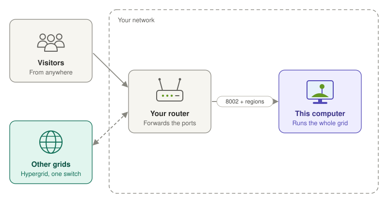
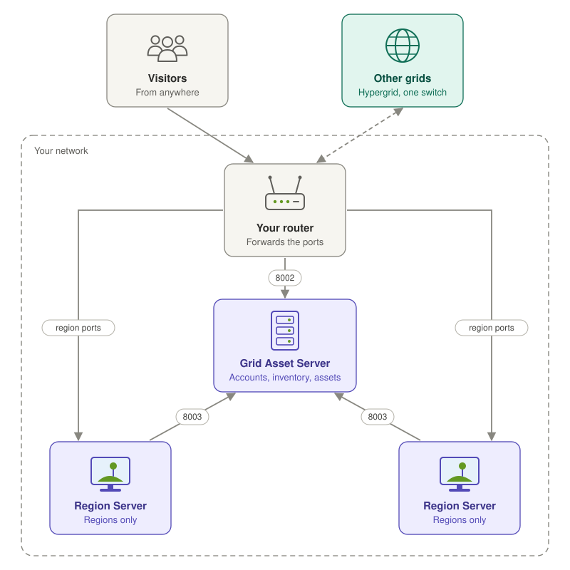
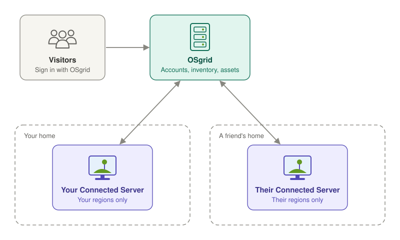

# GridGate-OpenSim

Your own OpenSimulator world, installed with one command and run from your browser.

This repository packages [OpenSim](http://opensimulator.org) with everything a world
needs: its own MariaDB database, the Robust grid services, the regions, and
**GridGate**, the website you run it all from. The installed package and its
service use the same name, so that is what you'll see in folders,
the service and the installer files.

It started as a fork of Outworldz DreamGrid and is now developed on its own, on
Debian Linux as well as Windows.

## What you get

**For you and your staff (the GridGate admin pages):**

* **A setup wizard** that names your world, creates your avatar and picks a
  [plan](#plans):
  * **Local:** just you and friends on your own network.
  * **Simple Public Server:** a world open to the internet.
  * **Grid Asset Server:** the centre of a grid other computers add regions to.
  * **Region Server:** this computer adds regions to someone's Grid Asset Server.
  * **Connected Server:** your regions on someone else's grid.
* **Home:** what's running, who's in-world, sign-ups waiting, and power controls
  for the whole world.
* **Regions:** a grid map you add regions to by dragging a region type onto it,
  each region's settings, moving regions, running several regions together to
  share memory, and saving or loading regions as OAR files.
* **Physics engines per region:** ubODE (with a much faster start-up for mesh-heavy
  regions), BulletSim, and Rapier (experimental, where its library is available).
* **People:** find residents, staff roles (owner, admin, supervisor), sign-up
  approval, support tickets, groups, estates, hypergrid links and takedowns.
* **Guest pages:** the splash page the viewer shows (with its own editor), the
  legal pages (Terms, Privacy, Cookies, Contact), sign-up with bot protection,
  the email server and password reset.
* **Security:** two-factor sign-in for staff, and you can limit the admin pages
  to the networks you name.

**For your residents (the GridGate guest pages):** a front page to sign in or
create an account, how to connect with Firestorm, their own account page, and a
way to ask for help.

## Plans

The first setup page asks what this computer will be. In the charts, purple
boxes are computers running GridGate, gray boxes are people and equipment, teal
is a grid someone else runs, and a dashed outline is your home or office
network.

You can move between Local, Simple Public Server and Grid Asset Server later,
in **Settings → Plan**. Moving to or from Region Server or Connected Server
means a new install.

### One computer

**Local** is the simplest start: everything runs on this computer, and only
computers on the same network can visit.

**Simple Public Server** is the same single computer, opened to the internet.
Your router forwards the grid's port (8002) and the region ports to it, and one
switch turns on hypergrid travel to and from other grids.

### Several computers

**Grid Asset Server with Region Servers.** One computer keeps the grid's
accounts, inventory and assets; every other computer on your network adds land
to it as a Region Server, joining on the private port 8003. Kept on your network
only, nobody outside can visit:

Give the Grid Asset Server a public address and the same grid opens to the
internet: the router forwards 8002 to the Grid Asset Server and each Region
Server's region ports to that computer.

**Connected Servers** run regions on a grid someone else runs, such as OSgrid.
That grid keeps the accounts and decides about hypergrid, and computers in
different homes can each add their own regions to it.

## Install

Every computer gets the same installer, whatever its plan. Each install ends
with a link: open it in your browser to pick the plan, name your world and
create your avatar. GridGate then sets the computer up for that plan.

### Debian 12 and 13 (amd64)

Run this as a user who can use sudo:

    curl -fsSL https://github.com/ystudy/GridGate-OpenSim/releases/latest/download/install.sh | sudo bash

It installs the system packages GridGate needs (MariaDB, libgdiplus, ICU),
downloads the latest release and checks it against the release's SHA256SUMS,
creates a `gridgate` system user, and installs and starts the `gridgate`
systemd service. It then prints the setup link.

To install a release you've already downloaded (for example on a computer
without internet access), pass the file:

    sudo bash install.sh --from gridgate-<version>-linux-x64.tar.gz

### Windows 10 and 11 (x64)

Download `GridGateSetup-<version>.exe` from the
[latest release](https://github.com/ystudy/GridGate-OpenSim/releases/latest)
and run it. The installer is not signed, so Windows SmartScreen may say
"Windows protected your PC": click **More info → Run anyway**. Allow
GridGate through the firewall if Windows asks. The installer sets up the
GridGate service and opens the setup link in your browser when it finishes;
the Start menu entry "GridGate admin page" opens the admin website later.

### Where things live

| | Debian | Windows |
|---|---|---|
| Your world's data (database, regions, settings, logs) | `/var/lib/gridgate` | `C:\ProgramData\GridGate` |
| The program | `/opt/gridgate` (its .NET runtime: `/opt/gridgate-runtime`) | `C:\Program Files\GridGate` |

Installing, upgrading and uninstalling never change, move or delete the data
folder.

### Upgrading

Run the same command again on Debian, or the newer installer on Windows. Your
world keeps running while the program is replaced, and the data is kept. The
grid service and regions restart briefly when a release updates OpenSim.

### Another web port

The admin website uses port 8001. If another program already uses it, pick
another port from 1024 to 65535 (not one GridGate uses itself: 3307, 8002,
8003, 8004, 8010 or 8011):

    curl -fsSL https://github.com/ystudy/GridGate-OpenSim/releases/latest/download/install.sh | sudo bash -s -- --web-port 8101

    GridGateSetup-<version>.exe /WEBPORT=8101

The installer saves the port in your world's settings, so upgrades keep it, and
you can change it later in Settings → Network.

### Testing a pre-release

Pre-releases (tags such as `v0.1.0-rc1`) are never the latest release, so the
commands above do not pick them up. On Debian, name the tag:

    curl -fsSL https://github.com/ystudy/GridGate-OpenSim/releases/download/v0.1.0-rc1/install.sh | sudo GRIDGATE_RELEASE=v0.1.0-rc1 bash

On Windows, download `GridGateSetup-<version>.exe` from that pre-release's
page on the [releases list](https://github.com/ystudy/GridGate-OpenSim/releases).

## Adding more computers

Set up the Grid Asset Server first. Then, on each other computer on the same
network, install the same GridGate version, choose **Region Server**, and type
the Grid Asset Server's address. GridGate reads everything else it needs from
that computer. You sign in with the avatar you already have there: no new
account.

Keep in mind:

* If the Grid Asset Server is off, every Region Server's regions stop working.
* Every computer on your network can reach the Grid Asset Server's private port
  (8003), so anyone on your network can add regions to the grid.
* Never forward the money port (8000 unless you changed it) on your router.

## Connecting with a viewer

Your world's login address is on the GridGate Home page (and on the guest
Connect page your residents see), for example `http://192.168.1.20:8002/`. Add it
in Firestorm under **Preferences → OpenSim → Grid Manager**, then sign in with
your avatar's name and password.

## Building from source

See [BUILDING.md](BUILDING.md). The GridGate website and the launcher are in
`Launcher/`; the installers are in `setup/` (see [setup/README.md](setup/README.md)).
For how releases are numbered and which OpenSimulator code they are built on, see
[VERSIONING.md](VERSIONING.md); for taking updates from OpenSimulator, see
[MERGING.md](MERGING.md).

## Bug reports

Report problems with installing or running a GridGate-OpenSim world on this
repository's [issues page](https://github.com/ystudy/GridGate-OpenSim/issues).
Include what you did, what happened, and the launcher log:
`/var/lib/gridgate/state/logs/launcher.log` on Debian, or the Logs page in
GridGate's Settings.

Problems in OpenSim itself are best reported on the
[OpenSim mantis system](http://opensimulator.org/mantis/main_page.php).

# Running OpenSim on its own

The rest of this file is OpenSim's own guide, for developers who run the
simulator by hand rather than through GridGate.

OpenSim is a BSD Licensed Open Source project to develop a functioning
virtual worlds server platform capable of supporting multiple clients
and servers in a heterogeneous grid structure. OpenSim is written in
C#, and runs on the Microsoft .NET runtime.

## On Windows

You will need the [dotnet 10.0 runtime](https://dotnet.microsoft.com/en-us/download/dotnet/10.0).

 * cd to the bin/ directory where you unpacked OpenSim
 * review and change configuration files (.ini) for your needs; see "Configuring OpenSim" below
 * run OpenSim.exe

## On Linux and Mac

You will need

 * the [dotnet 10.0 runtime](https://dotnet.microsoft.com/en-us/download/dotnet/10.0)
 * libgdiplus, from your package manager, for example on Debian:
   `apt-get update && apt-get install -y apt-utils libgdiplus libc6-dev`

Then, from the unpacked distribution:

 * cd bin
 * review and change configuration files (.ini) for your needs; see "Configuring OpenSim" below
 * run ./opensim.sh

## Configuring OpenSim

When OpenSim starts for the first time, you will be prompted with a
series of questions that look something like:

	[09-17 03:54:40] DEFAULT REGION CONFIG: Simulator Name [OpenSim Test]:

For all the options except simulator name, you can safely hit enter to accept
the default if you want to connect using a client on the same machine or over
your local network.

You will then be asked "Do you wish to join an existing estate?". If you're
starting OpenSim for the first time then answer no (which is the default) and
provide an estate name.

Shortly afterwards, you will then be asked to enter an estate owner first name,
last name, password and e-mail (which can be left blank). Do not forget these
details, since initially only this account will be able to manage your region
in-world. You can also use these details to perform your first login.

Once you are presented with a prompt that looks like:

	Region (My region name) #

You have successfully started OpenSim.

If you want to create another user account to login rather than the estate
account, then type "create user" on the OpenSim console and follow the prompts.

Helpful resources:
 * http://opensimulator.org/wiki/Configuration
 * http://opensimulator.org/wiki/Configuring_Regions

## Connecting to your OpenSim

By default your sim will be available for login on port 9000. You can login by
adding -loginuri http://127.0.0.1:9000 to the command that starts your viewer.
You can also login using the network IP address of the machine running OpenSim
(e.g. http://192.168.1.2:9000).

To login, use the avatar details that you gave for your estate ownership or the
one you set up using the "create user" command.

## More information on OpenSim

More extensive information on building, running, and configuring
OpenSim, as well as how to report bugs, and participate in the OpenSim
project can always be found at http://opensimulator.org.
